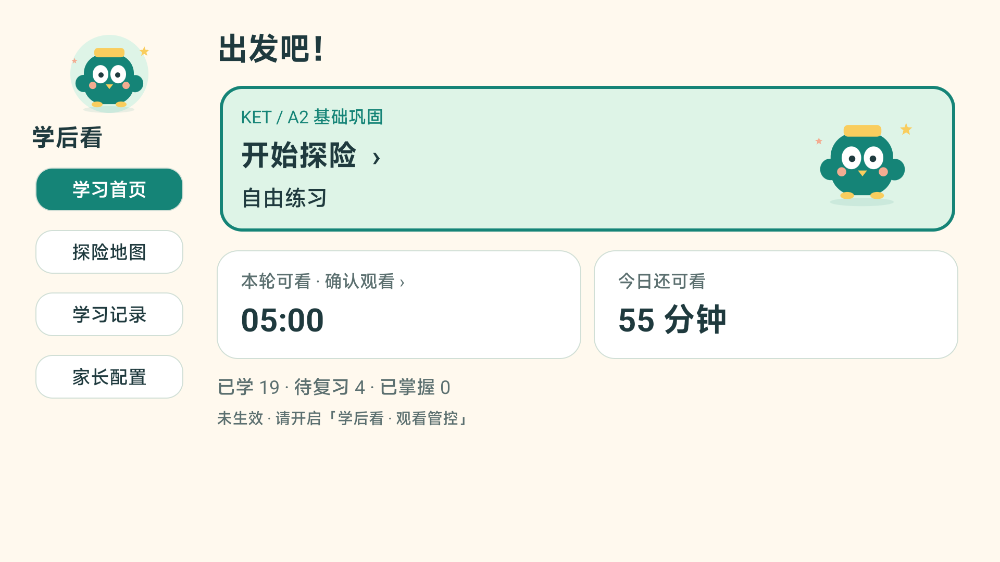
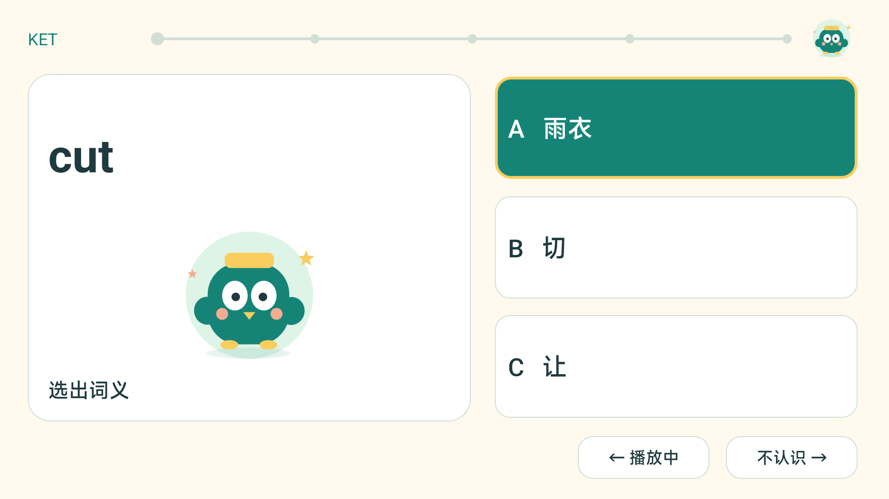
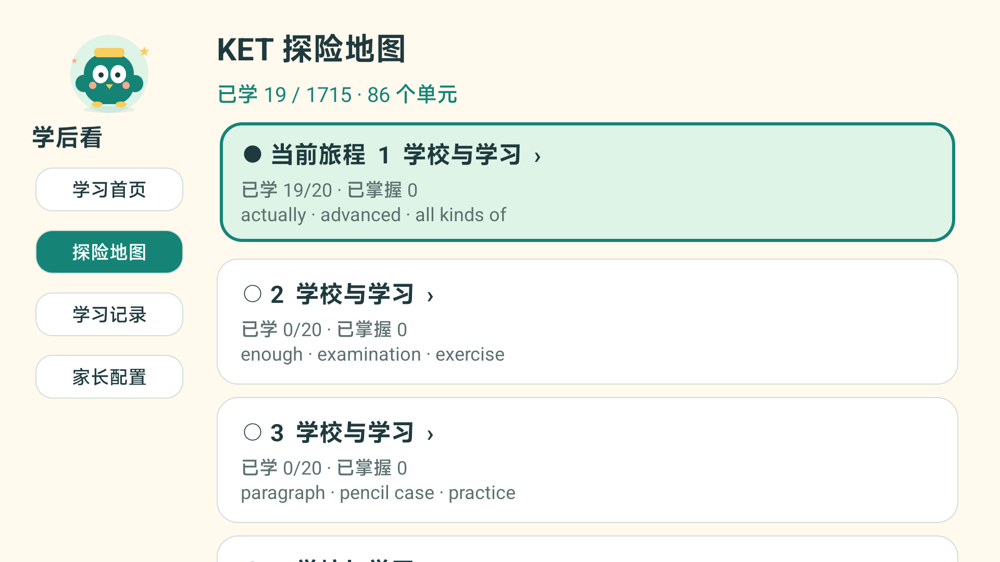
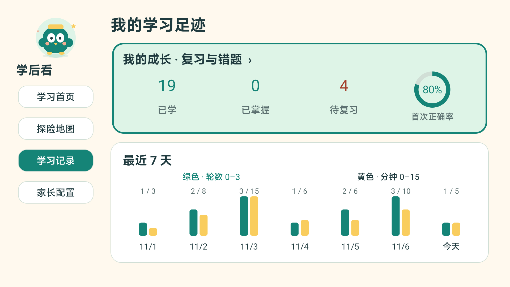
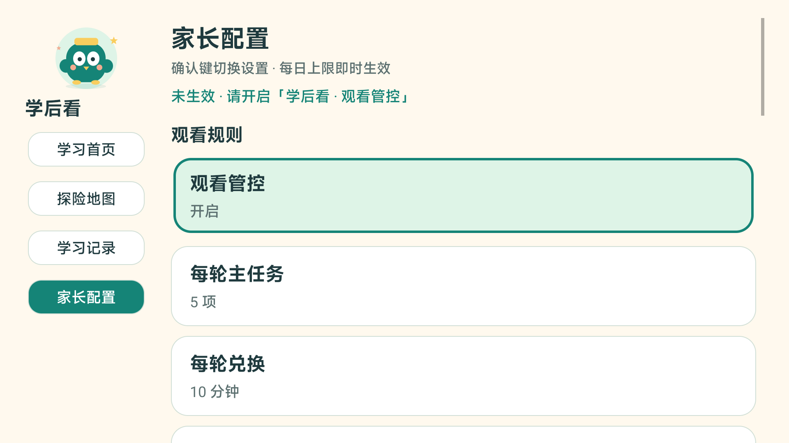

# 学后看 · LearnThenWatch

**先学一轮英语，再看一会儿电视。**

学后看是一款给家庭使用的电视英语学习应用，帮助已有英语基础的孩子积累 **KET / PET 词汇**。孩子每天用遥控器认单词、听发音、复习错词，完成学习后获得约定的观看时间；家长可以设置学习量和每天能看多久。

[下载学后看](https://github.com/scfido/LearnThenWatch/releases/latest) · [安装指南](docs/INSTALL.md) · [更新记录](CHANGELOG.md) · [反馈问题](https://github.com/scfido/LearnThenWatch/issues)

## 孩子能学到什么

如果孩子正在准备 KET / PET，或希望在已有基础上继续积累英语词汇，可以把学后看作为每天几分钟的词汇练习。

| 学习阶段 | 练习重点 |
| --- | --- |
| **KET 基础阶段**（[A2 Key](https://www.cambridgeenglish.org/exams-and-tests/qualifications/key/)） | 从家庭、学校、日常生活等常见话题入手，认识基础单词和常用表达，内置 1,715 个学习项 |
| **PET 进阶阶段**（[B1 Preliminary](https://www.cambridgeenglish.org/exams-and-tests/qualifications/preliminary/)） | 在基础词汇上继续扩展，结合例句练习理解单词和表达，内置 3,100 个学习项 |

两个阶段都可以练习：

- **认单词**：看英文选词义，配合中文释义和词卡学习。
- **听发音**：听录音选择单词，随时按左键重听。
- **看例句**：有合适例句的词条会结合句子出题。
- **复习错词**：答错后先看讲解，再集中订正；学过的词会按复习计划再次出现。

家长可以选择 KET 或 PET 阶段及学习起点，并查看已学词汇、待复习词和学习记录。课程用于日常词汇积累与复习；听说读写和考试练习可以结合孩子的其他学习安排。[课程范围与来源](docs/CONTENT.md)

## 怎样把学习融入看电视

- **先学后看**：默认每轮 5 项任务，完成订正后可看 10 分钟，每天最多看 60 分钟，家长可自行调整。
- **按实际观看计时**：暂停、浏览、待机和学习期间不扣时间，到时间后提醒孩子继续学习。
- **随时接着学**：退出后保留任务和进度，下次继续。
- **家长管理**：四位数字密码保护设置，孩子用遥控器就能完成学习。
- **离线使用**：课程和发音随应用提供，学习时不用联网。

## 界面预览

| 学习首页 | 学习与订正 |
| --- | --- |
|  |  |
| 探险地图 | 学习记录 |
|  |  |

## 选择一种安装方式

| 方式 | 需要准备什么 | 查看步骤 |
| --- | --- | --- |
| **Agent 安装** | 一台电脑。使用国内的 **TRAE、腾讯 WorkBuddy**，或国外的 **Codex、Claude Code、Cursor Agent**；先用遥控器打开电视 ADB 调试，按提示允许连接或配对，后续交给 Agent 完成 | [开启 ADB、配对与 Agent 安装](docs/INSTALL.md#方式一agent-安装) |
| **手动 U 盘安装** | 下载学后看的 APK，复制到 U 盘，插入电视后打开文件安装；无需开启 ADB | [U 盘安装步骤](docs/INSTALL.md#方式二手动-u-盘安装) |

## 装好后怎么用

1. 打开「学后看」，设置并确认四位家长密码，请妥善保存。
2. 在「家长配置」选择 KET / PET 阶段、学习起点和每天的学习量、观看时长。
3. 按应用提示，在电视无障碍设置开启「学后看 · 观看管控」，返回「监控检查」确认已连接。
4. 让孩子开始学习，完成任务和订正后选择「继续观看」。

| 遥控器按键 | 学习时的作用 |
| --- | --- |
| 上 / 下 | 选择答案或「不认识」 |
| 确认 | 提交答案 |
| 左 | 重听发音 |
| 右 | 答后继续；未作答时表示「不认识」 |
| 返回 | 保存进度并离开学习页 |

## 电视能用吗

需要支持 Android 应用安装的电视或盒子，Android 8.0 及以上。观看时间管理目前适配**云视听小电视**；其他使用场景仍可单独进行英语学习。

Android 投影仪同样需要满足上述条件。TCL / 雷鸟、OPPO、海尔 / 模卡、极米等设备的安装入口和常见问题见[特殊机型说明](docs/INSTALL.md#特殊机型说明)。

已在小米 MiTV-MFTR0 / Android 14 上测试。部分电视待机后会关闭无障碍授权；支持后台恢复的版本可让 Agent 配置额外授权，保留电视当前画面，实际效果需按电视验证。未配置或恢复失败时需重新开启无障碍服务。[安装指南](docs/INSTALL.md) · [兼容性说明](docs/VALIDATION.md)

## 需要帮助

- [安装指南](docs/INSTALL.md)：各品牌入口、配对、U 盘安装和常见问题。
- [使用中遇到问题](https://github.com/scfido/LearnThenWatch/issues)：请附电视品牌、完整型号、应用版本和问题现象。
- [隐私说明](PRIVACY.md)：了解学习记录和权限用途。
- [课程来源](docs/CONTENT.md) / [第三方声明](THIRD_PARTY_NOTICES.md)：了解词汇、例句与发音来源。

开发和贡献请参阅[开发文档](docs/BUILDING.md)与[贡献指南](CONTRIBUTING.md)。本项目原创代码与文档采用 [MIT](LICENSE) 协议。
