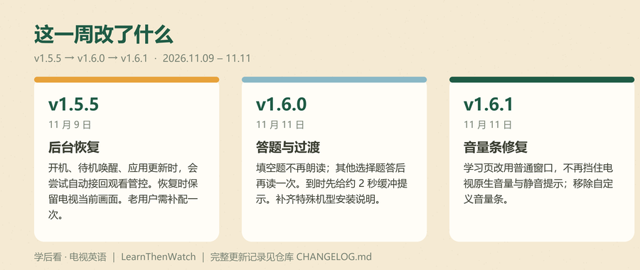
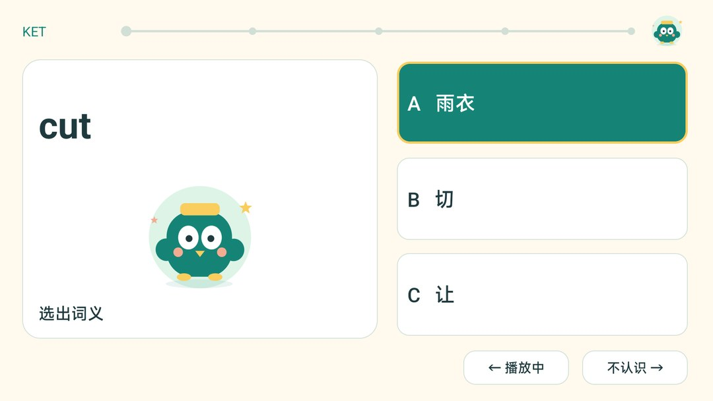

# 学后看 · 电视英语 · 版本新功能公众号文章（v1.6.1）

> 用途：11 月 9 日首篇发布后的第二篇，持续宣传 App。
> 依据：仓库 `CHANGELOG.md`、`README.md`、`docs/VALIDATION.md` 及提交 fb71966 / f4d652f / 12f8e94。
> 写作口径：平实、具体、少套话；不沿用首篇的叙事结构；事实边界与首篇保持一致（开源、两种安装方式、已知限制照直说）。
> 品牌口径：对外统一用「学后看 · 电视英语」，并带一句「先学一轮英语，再看一会儿电视」；系统无障碍服务名「电视英语 · 观看管控」按应用里的实际名称原样写，不跟着改。

---

## 一、候选标题（人工评估，非接口数据）

| # | 标题 | 点击力 30 | 传播力 25 | 吸引力 25 | 合规性 20 | 合计 |
| --- | --- | --- | --- | --- | --- | --- |
| 1 ⭐ | 学后看 · 电视英语：待机醒来，管控还在 | 26 | 21 | 22 | 20 | **89** |
| 2 | 一周三个版本，都是装到电视上才碰到的问题 | 22 | 22 | 23 | 20 | **87** |
| 3 | 电视一待机，管控就没了？这版补上了 | 27 | 19 | 20 | 19 | **85** |
| 4 | 给电视装完学习 App，我又拆了一层音量条 | 21 | 23 | 23 | 20 | **87** |
| 5 | v1.5.5 → v1.6.1：这周改了什么 | 16 | 18 | 17 | 20 | **71** |

**推荐第 1 个**：品牌名带上品类词，新读者不点进去也知道是电视上的英语应用；后半句给出家长最在意的那个变化。没有夸张词，不算标题党。标题按统一品牌组合调整过，评分沿用原人工判断。
如果这一篇主要发给已经装过的老读者，可以换第 2 个，更贴近内容本身。

---

## 二、正文（可直接发布）

<!-- ARTICLE_START -->

11 月 9 日那篇介绍发出去以后，本来想着能歇几天。结果是这一周连着发了三个版本：1.5.5、1.6.0、1.6.1。

没看过上一篇的，这里补一句：学后看 · 电视英语，先学一轮英语，再看一会儿电视。它是装在电视上的英语学习应用，孩子用遥控器学一轮 KET / PET 词汇，换一会儿观看时间；学习量和每天能看多久由家长设置，课程和发音都在安装包里，不用联网。

这三个版本没加新模块，改的基本都是把应用装到电视上、拿遥控器一点点试才碰到的问题。这篇把改了什么、已经装过的要补做什么，一次说完。

**比较麻烦的一个：电视睡一觉，管控就没了**

观看计时依赖系统的无障碍授权「电视英语 · 观看管控」。麻烦在于，不少电视待机之后会把这个授权关掉，第二天开机，时间到了也不会弹出学习页。上一篇里我把它写在「几句实话」中，当时只能给一句「唤醒后需要重新开启」。

v1.5.5 加了后台恢复：电视开机、待机唤醒，或者应用更新时，会尝试把观看管控自动接回来。恢复时保留电视当前画面，不会自己跳到学习页——孩子正在看什么，不该被一个后台动作打断。

有个前提得说清楚：**已经装过的用户，也要补做一次配置**。顺序是在应用里设好四位家长密码、开启观看管控，再让电脑上的安装助手照着安装指南配置后台恢复。配置一次就行；不配置，这个版本对你没有变化。

不同电视的恢复效果不一样。目前只在小米 MiTV-MFTR0 / Android 14 上验过开机、升级和约 10 秒的短待机唤醒，长时间待机、其他品牌固件还没验。如果唤醒后管控没生效，还是老办法：到系统无障碍设置里重新打开「电视英语 · 观看管控」。这条我不写成「彻底解决」，各厂商对后台的限制差得远。

**答题和切换，顺了几处**

v1.6.0 动的是答题的节奏。

填空题取消自动朗读，也不提供重听；其他选择题改成提交答案之后再读一次单词，答对时等朗读结束才自动进入下一题。听单词的时机固定下来，不会被下一题盖掉。

时间用完那一下也改了。以前是画面直接切到答题，现在先给约 2 秒的缓冲提示，再淡入学习页。就两秒，至少能知道是时间到了，不是电视卡了。

顺带把计时口径再说一遍：暂停、浏览、待机和学习期间都不扣观看时间。

**音量条：加了一层，两天后又拆了**

v1.6.0 里我给学习页加了一层自定义音量显示，想法很简单——学习页是全屏的，怕系统音量提示被盖住，按遥控器看不到反馈。

那版测试是直接给答题视图发按键，截图上音量提示画得好好的。但真实遥控器按下去，音量变化要经过系统那一层，截图证明不了那一层。结果就是：测试通过，电视上按音量键什么也不显示。

先试着把自定义音量条删掉，让系统自己显示，还是看不到——到时自动弹出的学习页用的窗口本来就在系统音量条上面，把它盖住了。最后 v1.6.1 把这个学习页整个换成普通应用窗口，不再压在系统音量条上，电视原生的音量和静音提示才露出来。

等于自己否了两天前刚加的东西。该拆就得拆，遥控器按下去没反应，比提示不好看难受得多。

**安装文档补了几页**

这段时间问得比较多的还是装不上：无线配对没弹码、安装被拦、无障碍授权开不了。文档里补了 TCL / 雷鸟、OPPO、海尔 / 模卡、极米等机型的入口和处理步骤，Android 投影仪也一并写了。

安装方式还是两种：把 APK 拷进 U 盘插到电视上装，不用开 ADB；或者让电脑上的 AI 助手照着文档自己连、自己装，话术写在文档里，复制过去改两行就能用。

**已经装过的，做这三件事**

1. 到 Releases 下载 v1.6.1 覆盖安装。学习记录、家长配置和进度会保留（1.5.4→1.5.5、1.5.5→1.6.0 都在电视上做过保留数据升级验证）。
2. 按上面说的补做一次后台恢复配置，老用户也要做。
3. 在应用里确认「电视英语 · 观看管控」显示已连接；待机唤醒后如果失效，手动重开一次。

**边界还是那几条**

需要 Android 8.0 及以上、能安装 APK 的电视或盒子；观看时间管理目前只适配云视听小电视，其他使用场景仍可以单独做英语学习；它只做 KET / PET 词汇积累与复习，听说读写和考试练习还得靠别的学习安排。这几条没变，写在这里省得装完失望。

项目还是开源的，原创代码与文档用 MIT 协议，课程内容的来源、许可和署名都列在仓库里。

github.com/scfido/LearnThenWatch

（复制到浏览器打开）

碰到问题的话，带上电视品牌、完整型号和应用版本号提到 GitHub Issues，我按机型查。这周这三个版本，就是这么一条一条改出来的。

<!-- ARTICLE_END -->

---

## 三、推荐标签

`#学后看` `#电视英语` `#LearnThenWatch` `#电视学习` `#KET` `#PET` `#亲子` `#开源项目` `#AndroidTV`

> 公众号正文一般不放话题标签，需要的话可放在文末灰色小字一行，不需要直接删掉。

---

## 四、封面方案（900 × 383，2.35:1）

| 项目 | 内容 |
| --- | --- |
| 主标题 | 学后看 · 电视英语 |
| 副标题 | 更新了：待机醒来，管控还在 |
| 固定句 | 先学一轮英语，再看一会儿电视 |
| 角标 | v1.6.1 · 本周三次更新 |
| 底部小字 | LearnThenWatch · 开源电视英语学习 |
| 主色 | 米黄底 `#F5EAD3`、深绿 `#1F5B45`（主文字 / 电视外框） |
| 辅色 | 暖橙 `#E7A23B`（强调与角标）、雾蓝 `#8AB8C6`（气泡）、浅绿 `#DCE9DC`（屏幕） |
| 构图 | 左 42% 文字区，右 58% 插画区；插画区压一个浅色大圆做底，视觉重心在电视屏幕 |
| 核心视觉元素 | 扁平电视（屏幕里是字母卡）、右上循环箭头更新徽章、右下三条音量柱、品牌小鸟、右侧绿植 |
| 文字规范 | 主标题约 38px 粗体（品牌组合略长，需收字号），副标题约 22px，固定句约 17px，角标约 14px；不用感叹号、不用「重磅 / 全新」等词 |
| 风格 | 扁平插画、无渐变、无阴影、粗描边；延续首篇封面的米黄＋深绿体系，让两篇推文在公众号主页里像同一套 |

**生图提示词（备用，2.35:1 横版，画面不含文字）**：
> 扁平矢量插画，米黄色纸张质感背景，右侧一台深绿边框的复古电视机，屏幕是浅绿色，里面有白色字母卡片；电视右上方一个橙色循环箭头小徽章，右下方三条橙色音量柱；一只深绿小圆鸟站在电视柜上，右侧一盆深绿绿植；暖橙、雾蓝点缀，粗描边，无渐变无阴影，柔和自然光，留白充足，左侧 40% 完全留白用于排文字，2.35:1 横版构图，无任何文字。

已按此方案生成可直接使用的封面：`images/cover.png`（900×383）。

---

## 五、合规自查（人工，非官方词库检测结果）

按风险等级排序，含原文片段、风险类型与替换建议：

| 等级 | 原文片段 / 风险点 | 风险类型 | 替换建议 |
| --- | --- | --- | --- |
| 中 | 「彻底解决」「全面适配」「保证恢复」（编辑时容易顺手加进去） | 广告法极限词 / 绝对化承诺 | 用「会尝试自动恢复」「不同电视恢复效果可能不同」；本文已按此写 |
| 中 | 「提分」「快速提高英语」「保证学会」 | 教育培训效果承诺 | 用「词汇积累与复习」「每天几分钟的练习」；本文未出现 |
| 低 | 「最省事」「问得最多」「最麻烦」 | 口语最高级，非商品宣传最高级，风险低 | 本文已改为「省事的做法」「问得比较多」「比较麻烦」 |
| 低 | 「一次说完」「配置一次就行」 | 无实质风险，仅避免读成承诺 | 保留；若担心，改「这篇写清楚」 |
| 提示 | 外链 | 公众号正文外链不可点 | 只放纯文本 `github.com/scfido/LearnThenWatch`，不加超链接（本文已按此写） |
| 提示 | 「转发 / 分享 / 关注领取」 | 诱导分享话术 | 全文不出现 |
| 提示 | KET / PET 词表、例句、发音 | 第三方内容署名 | 文中不宣称自有版权，指向仓库的来源与署名说明 |

**自查结论**：未发现高风险表述，事实性描述均可对应到 CHANGELOG / VALIDATION，可发布。
**未完成项**：官方违禁词库扫描需要 `REDFOX_API_KEY`，本机未配置，见下节。

---

## 六、数据说明（重要）

本次**没有获取到任何爆款数据**，因此不输出爆款数据表格，也不做「基于爆款规律的标题 / 内容 / 封面分析」——不编造数据。

原因：爆款文章、爆款标题、爆款封面与违禁词库四个数据接口都依赖 `REDFOX_API_KEY`，本次创作环境未配置该密钥，接口不可用。

因此：
- 标题评分表：人工按点击力 / 传播力 / 吸引力 / 合规性评估，不是接口返回的真实数据；
- 正文：依据仓库真实提交与文档撰写，未参考任何爆款文章；
- 封面方案：依据主题与首篇品牌视觉延续设计，未做同赛道爆款封面统计；
- 合规自查：人工规则检查，非官方词库扫描结果。

补跑方式：配置 `REDFOX_API_KEY` 后重新执行数据版流程，会先完整输出爆款数据表格，再重做标题评分、正文规律分析和封面风格统计。

---

## 七、配图与发布说明

| 文件 | 用途 | 位置 |
| --- | --- | --- |
| `images/cover.png` | 推文封面，900×383，后台单独上传 | 封面位 |
| `images/updates.png` | 本周三个版本速览，内嵌在正文 | 开头第三段之后 |
| `images/lesson.jpg` | 学习页界面示意（复用首篇素材） | 「答题和切换」段之后 |
| `学后看-v1.6.1-公众号文章.html` | 可直接粘贴到公众号图文编辑器的排版稿，图片已内嵌 | 复制白纸区域即可 |

发布顺序：后台上传封面 → 粘贴 HTML 白纸区域 → 填标题与摘要 → 检查两张正文图是否上传成功 → 预览手机端 → 发布。

**摘要建议**：学后看 · 电视英语一周连发三个版本：待机唤醒自动恢复观看管控、答题朗读与到时缓冲调整、把挡住系统音量条的那一层拆掉。老用户需要补做一次配置。
